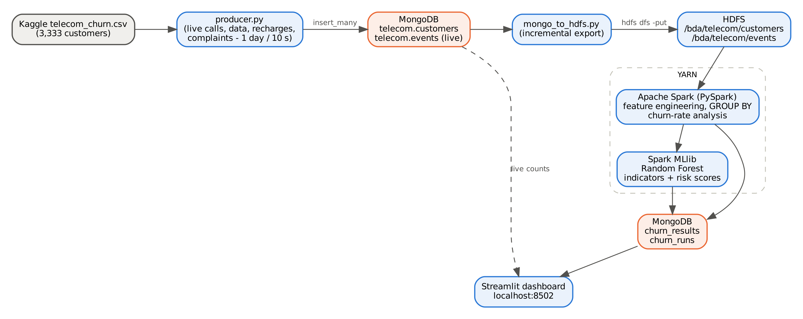

# Real-Time Telecom Customer Churn Analysis — Apache Spark + Hadoop + MongoDB

Big Data Analytics (BCS714D) project, Gopalan College of Engineering & Management — **Assignment Q45**:
*Given telecom customer data containing call duration, data usage, recharge history, complaints, service plan and customer status, use Spark/Hive to identify behavioural patterns associated with churn and determine important churn indicators.*

A producer streams live telecom activity — calls, roaming, data sessions, recharges and complaints — into **MongoDB**. Each pipeline run copies only new events into **HDFS**, and **Apache Spark** (on **YARN**) builds a behaviour profile per customer, measures churn rates across groups, ranks churn indicators with a **Spark MLlib Random Forest**, and scores active customers for churn risk. Results go back to MongoDB and a **Streamlit** dashboard.



## Documentation
- [Installation guide (requirements + full setup)](docs/INSTALLATION.md)
- [How it was built (design, steps, problems solved)](docs/HOW_IT_WAS_BUILT.md)
- [Running, clearing and viewing results](docs/RUNNING.md)

## Tech stack
Spark 3.5.3 (PySpark, MLlib) · Hadoop 3.3.6 (HDFS, YARN) · MongoDB 8.0 · Python 3.10 (PyMongo, NumPy) · Streamlit · Ubuntu 22.04 on WSL2 · OpenJDK 8

## Files
| File | Purpose |
|---|---|
| `producer.py` | Loads 3,333 customers, then streams one simulated day of events every 10 s into MongoDB |
| `mongo_to_hdfs.py` | Incremental ingestion of new events into HDFS (`/bda/telecom/events`) |
| `churn_analysis.py` | Spark analysis: features, churned vs active, churn rate by group, Random Forest, risk scores |
| `run_pipeline.sh` | One cycle; `SPARK_MASTER=yarn ./run_pipeline.sh` runs Spark on YARN |
| `dashboard.py` | Live dashboard (http://localhost:8502) |

## Dataset
Kaggle [Customer Churn (barun2104)](https://www.kaggle.com/datasets/barun2104/telecom-churn) — `telecom_churn.csv`, 3,333 customers, 483 churned (14.49%).
It is a widely used **synthetic** benchmark (originally from the MLC++ library, modelled on a US operator). Not included here — download it into `telecom_dataset/`.
Daily events are generated from each customer's own values; **the Churn column is never used to generate events**.

## Run
```bash
start-dfs.sh && start-yarn.sh
python3 -m streamlit run dashboard.py --server.headless true --server.port 8502   # tab 1
python3 producer.py telecom_dataset/telecom_churn.csv 30 10                       # tab 2
./run_pipeline.sh                    # tab 3: run a few times while data streams
SPARK_MASTER=yarn ./run_pipeline.sh  # final run on YARN
```

## Results (30 days, 494,714 events)
- Churners: **+18% call minutes**, longer calls, +11% recharge amount, **−44% data plans**, −23% contract renewal.
- Churn rate: 10–13% up to 3 complaints/month → **20.8% at 4 → 37.8% at 5+**. Not renewed ≈ 40% vs data plan + renewed 5.3%.
- **Top churn indicators** (Random Forest importance): call minutes 20.6%, contract renewal 19.4%, complaints 15.8%.
- Model (class-weighted): **AUC 0.808**, accuracy 84.4%, catches 59.8% of churners. 289 of 2,850 active customers flagged as high risk.

## Author
Nithelan Jayakumar — B.E. CSE, Gopalan College of Engineering & Management, Bengaluru
